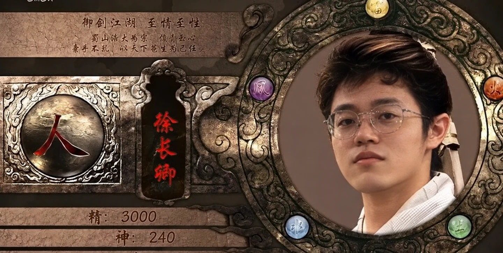

  

# 董信步 · XB-Dong

**AI Agent · 全栈工程 · 运筹优化** 
深圳大学人工智能硕士在读，本科毕业于吉林大学机械工程。将模型能力落到具体问题中。

[Google Scholar](https://scholar.google.com/citations?hl=zh-CN&user=4w56hlIAAAAJ) &nbsp; · &nbsp; [Research](https://github.com/TIO-Team/LLM-NHO) &nbsp; · &nbsp; [Repositories](https://github.com/XB-Dong?tab=repositories)

##  Projects

### [ccagent](https://github.com/XB-Dong/ccagent) &nbsp; 

基于 **DeepSeek Harness** 的亚马逊运营 AI 工作台。串联任务与活动日历、库存补货和广告分析，积累经用户确认的业务记忆与可复用经验。

`React` · `TypeScript` · `Node.js` · `SQLite` · `DeepSeek Harness`

### [Classroom Annotator](https://github.com/XB-Dong/classroom-annotator)

面向课堂视频的人机协同标注工具，连接视频抽帧、AI 预标注、人工复核、多人协作与 COCO 数据集导出。

### [ByteDanceliveauctioni](https://github.com/byte-ai-fullstack/ByteDanceliveauctioni)

参与开发的全栈直播电商竞拍系统，覆盖实时竞价、订单结算与 AI 语义检索。参赛获第二名，担任「粤海带专」队长。

##  Research

**[LLM-NHO](https://github.com/TIO-Team/LLM-NHO)** — 大模型驱动的神经–启发式大规模路径优化，探索 TSP / CVRP 求解。

论文 *Large Language Model-Driven Neural-Heuristic Optimization for Large-Scale Routing Problems* 发表于 **IEEE Transactions on Evolutionary Computation（TEVC）**，导师一作、本人二作。

[Paper](https://ieeexplore.ieee.org/abstract/document/11509330/) &nbsp; · &nbsp; [Google Scholar](https://scholar.google.com/citations?hl=zh-CN&user=4w56hlIAAAAJ)

##  Open Source

- **[深大中文简历模板](https://github.com/XB-Dong/Chinese-Resume-Template-of-SZU)**：面向深大校友的中文 Overleaf 简历模板。
- **[求职简历模板](https://github.com/XB-Dong/SZU-Job-Resume)**：面向求职场景的 Overleaf 简历模板。

##  Highlights

- 字节跳动 · 抖音电商 AI 全栈挑战赛 **第二名**，「粤海带专」队长
- 腾讯开悟 · 人工智能挑战赛，智能体决策算法高级赛道区域赛 **华南赛区二等奖**
