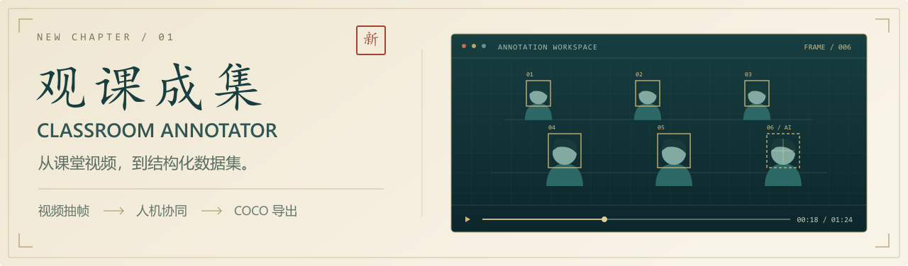

  

  <b>董信步 · XB-Dong</b> 
  AI 全栈践行者 · 大模型探索者 · 运筹优化 
  人工智能 · 深圳大学 &nbsp; / &nbsp; 机械工程 · 吉林大学

  <a href="#壹--新作入卷">新作</a> &nbsp; · &nbsp;
  <a href="#贰--工程与问道">工程与研究</a> &nbsp; · &nbsp;
  <a href="#叁--开源赠友">开源</a> &nbsp; · &nbsp;
  <a href="#肆--行路有光">荣誉</a> &nbsp; · &nbsp;
  <a href="https://scholar.google.com/citations?hl=zh-CN&amp;user=4w56hlIAAAAJ">Google Scholar</a>

 

## 壹 · 新作入卷

### [Classroom Annotator ↗](https://github.com/XB-Dong/classroom-annotator)

**从课堂视频，到结构化数据集。** 把视频抽帧、人工框选、AI 候选复核与多人协作串成完整的学生人头标注流程。

- **人机共作**：手动精修与 AI 预标注衔接，候选框逐项审核后再入库。
- **协作有序**：共享工作区、自动保存与草稿恢复，处理多人编辑冲突。
- **数据成集**：按批次抽帧，导出 COCO 数据集，接入后续训练流程。

`React` `TypeScript` `Konva` &nbsp; / &nbsp; `Go` `PostgreSQL` `FFmpeg` &nbsp; / &nbsp; `Python` `ONNX`

 

## 贰 · 工程与问道

### [ByteDanceliveauctioni ↗](https://github.com/byte-ai-fullstack/ByteDanceliveauctioni) &nbsp; · &nbsp; 全栈成器

**字节跳动 · 抖音电商 AI 全栈挑战赛第二名**，参赛队伍「粤海带专」队长。

作为合作者参与全栈直播电商竞拍项目：连接商家与买家双端，以 WebSocket 同步实时竞价，用 Redis Lua 完成出价裁决，覆盖订单结算与 AI 语义检索。

`Go` `React` `TypeScript` `WebSocket` `Redis Lua` `AI Search`

---

### [LLM-NHO ↗](https://github.com/TIO-Team/LLM-NHO) &nbsp; · &nbsp; 研究问道

**大模型驱动的神经–启发式大规模路径优化。** 用大模型生成启发式，结合神经求解器探索 TSP / CVRP 路径优化。

论文 **Large Language Model-Driven Neural-Heuristic Optimization for Large-Scale Routing Problems** 发表于 **IEEE Transactions on Evolutionary Computation（TEVC，SCI 一区 TOP）**，导师一作、学生二作。

`LLM` `Neural-Heuristic Optimization` `TSP` `CVRP`

[论文 ↗](https://ieeexplore.ieee.org/abstract/document/11509330/) &nbsp; · &nbsp; [学术主页 ↗](https://scholar.google.com/citations?hl=zh-CN&user=4w56hlIAAAAJ)

 

## 叁 · 开源赠友

> 将走过的路，留一盏灯给后来的人。

- **[Chinese-Resume-Template-of-SZU ↗](https://github.com/XB-Dong/Chinese-Resume-Template-of-SZU)**：面向深大校友的中文简历 Overleaf 模板，让第一份简历也能端正清朗。
- **[SZU-Job-Resume ↗](https://github.com/XB-Dong/SZU-Job-Resume)**：面向求职场景的 Overleaf 简历模板，把经历写清，把重点留住。

 

## 肆 · 行路有光

| 所历 | 所得 |
| :--- | :--- |
| 字节跳动 · 抖音电商 AI 全栈挑战赛 | **第二名** ·「粤海带专」队长 |
| 腾讯开悟 · 人工智能挑战赛 | 智能体决策算法高级赛道区域赛 · **华南赛区二等奖** |

 

  

  <a href="https://github.com/XB-Dong?tab=repositories">翻阅全部作品 ↗</a> &nbsp; · &nbsp;
  <a href="https://scholar.google.com/citations?hl=zh-CN&amp;user=4w56hlIAAAAJ">学术交流 ↗</a>

